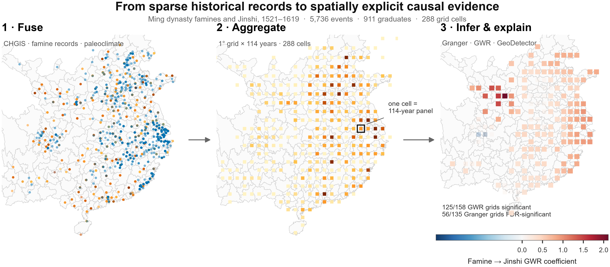
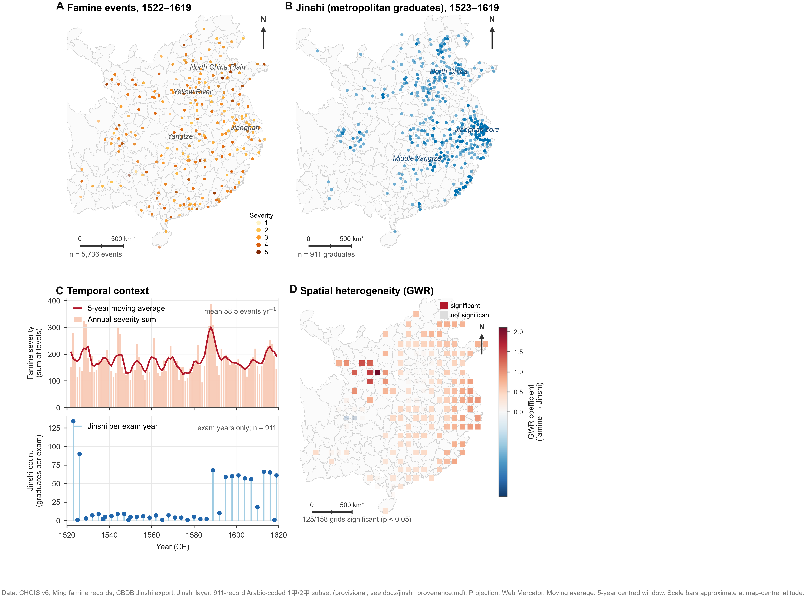
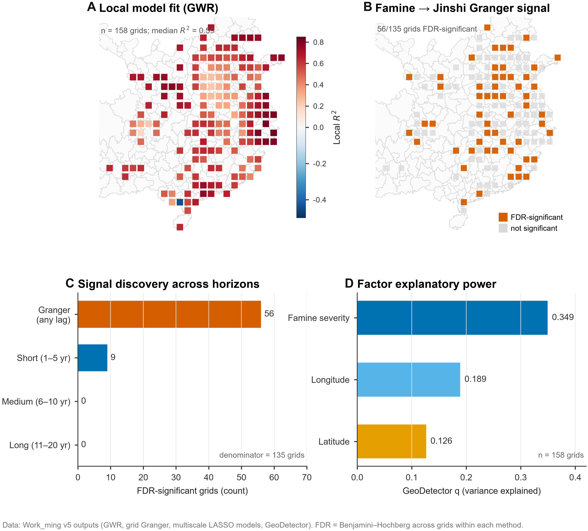
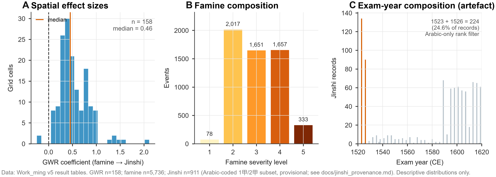

# Famines and Imperial Exams in Ming China, 1521–1619

**A reproducible spatiotemporal analysis of 5,736 famine records and 911 Jinshi
(metropolitan exam) records — from event points to grid-level causal evidence.**
The 911-record Jinshi layer is an Arabic-numeral-coded 1甲/2甲 subset
(provisional; see [docs/jinshi_provenance.md](docs/jinshi_provenance.md)).



**Live gallery:** <https://charles-delapore.github.io/ming-famine-jinshi/>

> **Scope.** Personal research project (Ming dynasty historical GIS). Code and
> figures are reproducible from the raw event tables; historical data are not
> redistributed in this repository.

## At a glance

| | |
|---|---|
| **Question** | Did environmental shocks suppress elite educational attainment in Ming China — and where? |
| **Data** | 5,736 famine events (1522–1619), 911 Jinshi graduates (1523–1619), CHGIS v6 administrative points, Mann 2009 / Schneider 2015 paleoclimate reconstructions |
| **Panel** | 1° × 1° grid × 114 years = 288 cells; 135 cells with estimable Granger models |
| **Methods** | event→grid aggregation, SS-DBSCAN / ST-DBSCAN / GMM (exploration), Granger causality with FDR, GWR, GeoDetector, SHAP / GeoShapley, STL, CCM (robustness) |
| **Stack** | Python 3.13 · pandas · GeoPandas · PySAL · mgwr · statsmodels · scikit-learn · SHAP · Matplotlib |

## Why this project

Historical famine and examination data are sparse, unevenly recorded, and
spatially clustered. A naive map or a dual-axis trend chart can suggest a
relationship that the data cannot support. This project treats the data as a
**spatially explicit panel** and asks three separable questions:

1. **Pattern** — where are famines and Jinshi located, and do the distributions overlap?
2. **Mechanism** — does famine history predict later Jinshi output at the grid level?
3. **Heterogeneity** — is the relationship stable across space and time horizons?

The result is a pipeline that is honest about what sparse historical data can
and cannot identify — including a documented negative result for CCM.

## Findings

- **Spatial mismatch.** Famine events form broad river-basin belts (Yellow River,
  Yangtze, North China Plain), while Jinshi are concentrated in the Jiangnan /
  lower-Yangtze core. The two distributions overlap only partially
  (Fig. 1A–B).
- **Spatially selective signal.** After Benjamini–Hochberg FDR correction,
  famine→Jinshi Granger causality is significant in **56 / 135** grid cells
  (Fig. 2B).
- **Short horizons dominate.** Multiscale LASSO/BIC models find **9**
  FDR-significant grids at 1–5 years, and **0** at 6–10 and 11–20 years
  (Fig. 2C). The long-run “effect” seen in simpler Granger models is not robust
  once derived features are controlled.
- **Spatial heterogeneity.** GWR coefficients are mostly positive in the
  central/eastern grids and negative in a few southwestern cells; **125 / 158**
  grids are locally significant, median local R² = 0.59 (Fig. 1D, 2A).
- **Famine severity is the strongest factor.** GeoDetector q = **0.349** for
  famine severity, **0.189** for longitude and **0.126** for latitude
  (Fig. 2D).
- **A useful negative result.** CCM (convergent cross-mapping) could not be
  estimated reliably: the 114-year series are zero-inflated, so the shadow
  manifold degenerates. This is reported as a methodological limitation, not
  hidden.

## Figures

### Figure 1 — Pattern and spatial heterogeneity



5,736 famine events (A), 911 Jinshi (B), aligned temporal context with exam-year
counts (C), and GWR coefficients (D). Basemap: CHGIS v6; projection: Web
Mercator.

### Figure 2 — Grid-level mechanism



Local model fit (A), FDR-significant famine→Jinshi Granger grids (B), discovery
across horizons (C), and GeoDetector q values (D).

### Figure 3 — Graphical abstract


From sparse event records to a 1° grid panel and spatially explicit evidence.

### Figure 4 — Statistical companion



GWR coefficient distribution (A), famine severity composition (B), and Jinshi
records by exam year (C). **Panel C is an encoding audit, not a historical
claim**: the 1523/1526 concentration comes from the old Arabic-only rank filter
(see [docs/jinshi_encoding_audit.md](docs/jinshi_encoding_audit.md)).

### Interactive map

[Open the 1° aggregated map](web/interactive_map.html) — famine severity,
Jinshi totals, GWR coefficients and FDR-significant Granger cells. Every layer
is a grid-level aggregate; individual historical records are not embedded.

## Method in four steps

1. **Fuse** — harmonise CHGIS administrative points, famine records, Jinshi
   records, and paleoclimate reconstructions; keep provenance for every table.
2. **Aggregate** — project events to a 1° grid, build a 114-year panel with
   severity, frequency, duration, cumulative intensity and lag features.
3. **Infer** — run grid-level Granger tests (FDR), multiscale LASSO/BIC models,
   GWR and SDM; use GeoDetector for factor explanatory power.
4. **Explain** — use SHAP / GeoShapley for feature attribution; audit the result
   with STL and CCM; separate exploratory clustering from inferential evidence.

## Reproducibility

```bash
# Python 3.13 + uv
uv venv
uv pip install -r requirements-viz.txt   # figure-only subset
python scripts/fig1_patterns.py
python scripts/fig2_mechanism.py
python scripts/fig3_framework.py
python scripts/fig4_distribution.py
python scripts/make_interactive_map.py
```

- Analysis layer: `src/` (module map in [src/README.md](src/README.md)); the
  14-step orchestrator is `run_pipeline.py`.
- Full dependencies: `requirements-analysis.txt`; the optional CGAN branch is
  in `requirements-ml.txt`.

- Figure scripts read result tables from `MING_OUTPUT` (default: `output/`) and
  write PDF + SVG + 600 dpi PNG to `figures/`.
- The shared style module is `style/ming_style.py`.
- Design rationale: [docs/design_notes.md](docs/design_notes.md).
- Figure contracts and style rules: [docs/figure_plan.md](docs/figure_plan.md).
- Figure QA and colour-blind checks: [docs/figure_qa.md](docs/figure_qa.md).
- Reproducibility fixes (row order, colour limits, grid bounds):
  [docs/reproducibility_fixes.md](docs/reproducibility_fixes.md).
- Jinshi provenance (confirmed 2026-11-14):
  [docs/jinshi_provenance.md](docs/jinshi_provenance.md).
- Jinshi rank-encoding audit (why the 911 layer is a subset):
  [docs/jinshi_encoding_audit.md](docs/jinshi_encoding_audit.md).
- Data provenance overview: [docs/data_provenance.md](docs/data_provenance.md).
- Interactive map notes: [web/README.md](web/README.md).
- Zenodo DOI release steps: [docs/zenodo_release.md](docs/zenodo_release.md) — **DOI pending** the author's Zenodo release.
- Data sources and transformations are recorded in the figure footnotes.

### Synthetic sample data

The real event tables are private, so the repository ships a **synthetic** sample
with identical columns: `data/sample/` (seed `20261113`). It exercises the code
and figure layout without redistributing historical records or the CHGIS basemap.

```bash
python scripts/make_sample_data.py
python scripts/run_sample_figures.py   # writes figures/sample/ (fig 1–4)
python scripts/make_interactive_map.py --sample --output web/sample/interactive_map.html
```

The sample figures carry a “synthetic sample” footnote. See
[data/sample/README.md](data/sample/README.md) for provenance and limitations.

## Limitations

- Historical records are **not a random sample**; reporting intensity varies by
  region and period. The 911-record Jinshi layer is a **format-selected subset**
  of the CBDB 1甲/2甲 elite (Arabic-numeral ranks only), not a representative
  sample. Corrected elite denominator: 2,853 records (2,841 with coordinates);
  the 1523/1526 peak is an encoding artefact. See
  [docs/jinshi_provenance.md](docs/jinshi_provenance.md) and
  [docs/jinshi_encoding_audit.md](docs/jinshi_encoding_audit.md). Figures and
  models using the 911 layer are provisional.
- Granger causality is **predictive**, not mechanistic; the “famine → Jinshi”
  language is shorthand for “famine history improves prediction of later Jinshi
  counts”.
- Grid-level results are sensitive to the 1° resolution; the sensitivity analysis
  is reported separately in the project outputs.
- CCM is not identifiable with these zero-inflated series; the project reports
  that failure rather than tuning it away.

## What I would do next

- Add a Bayesian hierarchical version with spatial random effects and explicit
  reporting-bias terms.
- Replace the 1° grid with a multi-resolution sensitivity surface (0.5°/1°/2°)
  and report the stability of the 56 significant cells.
- Publish an interactive map (grid-level FDR + GWR coefficients) with a static
  fallback for accessibility.

## About

**Charles** — geospatial data science, Python GIS automation, spatial
econometrics and explainable ML.
[GitHub](https://github.com/Charles-delapore) · delapore@163.com

---

*If you use the figure style or the pipeline, cite the data sources (CHGIS,
Mann et al. 2009, Schneider et al. 2015) and this repository.*


