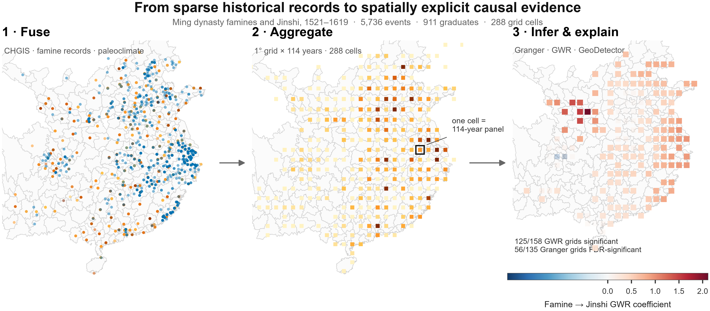
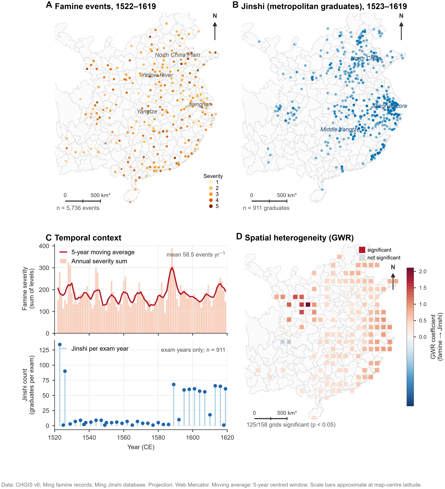
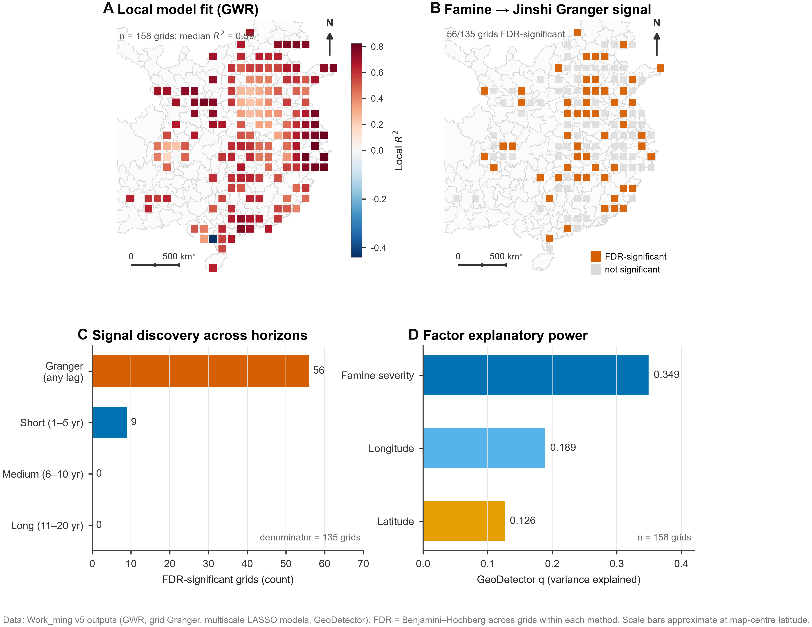
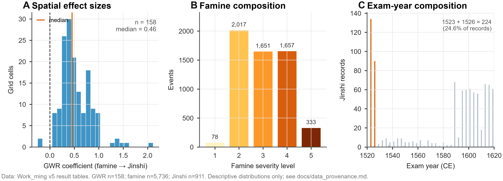

# 明代灾荒与进士的时空分析（1521–1619）

**5,736 条灾荒记录 + 911 位进士：从历史事件点，到格网级因果证据的可复现空间分析。**



> 个人研究项目（明代历史 GIS）。代码与图件可由原始事件表复现；历史数据不在仓库中再分发。

## 项目速览

| | |
|---|---|
| **问题** | 明代灾荒是否抑制了进士产出？这种关系在空间和时间上是否稳定？ |
| **数据** | 灾荒事件 5,736 条（1522–1619）、进士 911 位（1523–1619）、CHGIS v6 行政点位、Mann 2009 / Schneider 2015 古气候重建 |
| **面板** | 1° × 1° 格网 × 114 年 = 288 个格网单元；135 个可估计 Granger 的格网 |
| **方法** | 事件→格网聚合、SS-DBSCAN / ST-DBSCAN / GMM（探索）、Granger + FDR、GWR、地理探测器、SHAP / GeoShapley、STL、CCM（稳健性） |
| **技术栈** | Python 3.13 · pandas · GeoPandas · PySAL · mgwr · statsmodels · scikit-learn · SHAP · Matplotlib |

## 主要发现

- **空间错位**：灾荒沿黄河、长江与华北平原形成带状分布；进士高度集中在江南/长江下游。两者只部分重叠（图 1A–B）。
- **信号具有空间选择性**：经 FDR 校正后，灾荒→进士的 Granger 因果在 **56 / 135** 个格网显著（图 2B）。
- **短期效应为主**：多尺度 LASSO/BIC 模型在 1–5 年尺度有 **9** 个 FDR 显著格网，6–10 年与 11–20 年均为 **0**（图 2C）。简单 Granger 中的“长期效应”在控制衍生特征后不再稳健。
- **空间异质性明显**：GWR 系数在中东部多为正，少数西南格网为负；**125 / 158** 个格网局部显著，局部 R² 中位数 0.59（图 1D、2A）。
- **灾荒强度是最强因子**：地理探测器 q 值：灾荒强度 **0.349**、经度 **0.189**、纬度 **0.126**（图 2D）。
- **一个有价值的负结果**：CCM 在零值过多的 114 年序列上无法可靠估计，影子流形退化。项目如实记录这一局限，而不是调参掩盖。

## 图件

### 图 1 — 空间格局与异质性



灾荒事件（A）、进士（B）、对齐的时间序列（C）、GWR 系数（D）。

### 图 2 — 格网级机制证据



局部模型拟合（A）、FDR 显著的灾荒→进士 Granger 格网（B）、不同时间尺度的显著格网数（C）、地理探测器 q 值（D）。

### 图 3 — 图形摘要


从稀疏事件记录到 1° 格网面板，再到空间显式证据。

### 图 4 — 统计伴随图



GWR 系数分布（A）、灾荒等级构成（B）、进士按科年分布（C）。这是地图的数值伴随图（S6），1523/1526 的集中度被明确展示。

### 交互地图

[打开 1° 聚合地图](web/interactive_map.html) —— 灾荒强度、进士总量、GWR 系数、FDR 显著 Granger 格网；全部为格网级聚合，不含个体记录。

## 方法四步

1. **融合**：统一 CHGIS、灾荒、进士、古气候数据，保留每条数据的来源与变换。
2. **聚合**：投影到 1° 格网，构建 114 年面板，生成强度、频率、持续时间、累积强度与滞后特征。
3. **推断**：格网级 Granger（FDR）、多尺度 LASSO/BIC、GWR/SDM、地理探测器。
4. **解释**：SHAP / GeoShapley 归因，STL 与 CCM 稳健性审计；明确区分“探索性聚类”和“推断性证据”。

## 复现方式

```bash
uv venv
uv pip install -r requirements-viz.txt
python scripts/fig1_patterns.py
python scripts/fig2_mechanism.py
python scripts/fig3_framework.py
python scripts/fig4_distribution.py
python scripts/make_interactive_map.py
```

- 图件脚本从 `MING_OUTPUT`（默认 `output/`）读取结果表，输出 PDF + SVG + 600 dpi PNG。
- 统一风格模块：`style/ming_style.py`。
- 代码结构：[src/README.md](src/README.md)；图件规范：[docs/figure_plan.md](docs/figure_plan.md)。
- 图件 QA 与色盲检查：[docs/figure_qa.md](docs/figure_qa.md)；可复现性修复：[docs/reproducibility_fixes.md](docs/reproducibility_fixes.md)。
- 进士样本来源与入选标准：[docs/data_provenance.md](docs/data_provenance.md)（待作者确认）。
- Zenodo DOI 待作者账号发布；步骤见 [docs/zenodo_release.md](docs/zenodo_release.md)。

### 合成样例数据

真实事件表不公开，仓库提供同列名的**合成样例**：`data/sample/`（随机种子 `20261113`）。

```bash
python scripts/make_sample_data.py
python scripts/run_sample_figures.py   # 输出到 figures/sample/
python scripts/make_interactive_map.py --sample --output web/sample/interactive_map.html
```

样例图会带“synthetic sample”标注；详见 [data/sample/README.md](data/sample/README.md)。

## 局限

- 历史记录不是随机样本，地区与时期的记录强度差异很大；911 位进士的来源与入选标准仍待确认，见 [docs/data_provenance.md](docs/data_provenance.md)。
- Granger 是**预测性**因果，不是机制性因果。
- 1° 格网结果对分辨率敏感，项目另做了 0.5°/1°/2° 敏感性分析。
- CCM 在零膨胀序列上不可识别；项目保留这一负结果。

## 关于

**Charles** — 空间数据科学、Python GIS 自动化、空间计量与可解释机器学习。  
[GitHub](https://github.com/Charles-delapore) · delapore@163.com

